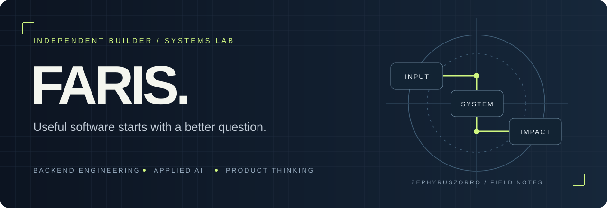

<!-- Generated by generate.py. Edit profile.json, then regenerate. -->

# I turn messy inputs into useful systems.

**Faris Ruknuddin** · Bhatkal, India · Building at **Omnimate**

Backend engineering, applied AI, and the workflows that connect them. From case documents to screenshots to computer vision, I build around a simple question: what can this input become?

[Explore the code](https://github.com/ZephyrusZorro?tab=repositories) · [LinkedIn](https://linkedin.com/in/faris-ruknuddin-3656762b9) · [Start a conversation](mailto:farisruknuddin@gmail.com)

---

## The lab, in four experiments

Each project starts with an input. The interesting part is what happens next.

### 01 / TRUST · [CaseVault](https://github.com/ZephyrusZorro/case-vault)

A case-document workspace with encrypted evidence, version history, case-level access, and linked audit records.

`Document → encrypted evidence → searchable case history`

Python / FastAPI / React / TypeScript

### 02 / RETRIEVAL · [Omnimate Shots](https://github.com/ZephyrusZorro/Omnimate-Shots)

Screenshot ingestion, metadata indexing, and an HTTP search API. Built around file metadata and sidecar data.

`Screenshot → metadata → retrievable context`

TypeScript / Node.js

### 03 / VISION · [Communiti](https://github.com/ZephyrusZorro/project-mrindustries)

A virtual try-on proof of concept using pose landmarks and 2D garment overlays, with measurement and recommendation experiments.

`Photo + garment → pose landmarks → visual preview`

Python / Flask / MediaPipe / OpenCV

### 04 / INTERFACE · [FARIS. Portfolio](https://github.com/ZephyrusZorro/portfolio)

My personal portfolio, built with a component-based interface and motion-led project storytelling.

`Projects → visual stories → conversations`

Next.js / React / TypeScript / Framer Motion

---

## Beyond the public repositories

A wider collection of projects from my portfolio, spanning voice, security, and everyday workflows.

### Voice &amp; automation

**Vox AI** — Turns recorded calls into structured notes and follow-up tasks.

**OmniConnect** — An AI receptionist workflow for answering calls, qualifying enquiries, and booking appointments.

**AI Content &amp; Video Production Engine** — Connects script generation, voice synthesis, visuals, and video assembly in one content workflow.

### Security &amp; infrastructure

**Leakage Guard** — Explores anomaly detection for data leakage in network traffic and ML pipelines.

**Cloud File Storage System** — A file-storage application combining authentication, role-based access, and AWS S3 storage.

### Applied software

**Omnimate Health System** — Healthcare workflows for patient scheduling, health records, and practice administration.

**AI Traffic Signal Optimization** — Uses computer vision to estimate vehicle density and explore adaptive signal timing.

**TikTok Analysis Engine** — Explores content trends using engagement data, sentiment analysis, and visual reporting.

**Carbon Emission Calculator** — Estimates a personal carbon footprint from lifestyle inputs in a full-stack application.

---

## How I think about building

> Start with the workflow. Give the data a shape. Make the result useful.

- **Backend:** APIs, data models, access boundaries, and traceable state changes.
- **Applied AI:** computer vision and automation connected to usable interfaces.
- **Product:** clear paths from a messy input to a meaningful next action.

<b>Open the repository index</b>

7 public owned repositories. Refreshed by the generator; private repositories are excluded.

| Repository | Field note | Main language |
| :--- | :--- | :--- |
| [case-vault](https://github.com/ZephyrusZorro/case-vault) | Case document management; repository description still refers to the earlier ID-SHIELD prototype. | Python |
| [Omnimate-Shots](https://github.com/ZephyrusZorro/Omnimate-Shots) | Screenshot metadata ingestion and search API. | TypeScript |
| [omnimateScanbox](https://github.com/ZephyrusZorro/omnimateScanbox) | Paper-to-PDF repository placeholder; no source files at review time. | — |
| [portfolio](https://github.com/ZephyrusZorro/portfolio) | Next.js personal portfolio. | TypeScript |
| [project](https://github.com/ZephyrusZorro/project) | Small HTML/CSS/JavaScript portfolio scaffold. | HTML |
| [project-mrindustries](https://github.com/ZephyrusZorro/project-mrindustries) | Pose-based virtual try-on proof of concept. | Python |
| [ZephyrusZorro](https://github.com/ZephyrusZorro/ZephyrusZorro) | Faris Ruknuddin — Systems Lab. Backend engineering, applied AI, and useful software. | — |

---

**Have a workflow that deserves better software?**

[Let’s build it.](mailto:farisruknuddin@gmail.com)

Built with intent. Updated from source. Always another experiment.
