<!-- Autogenerated by generate.py. Edit profile.json and re-run. -->
<div align="center">

<!-- ================================================================= -->
<!-- 1. LIVE ANIMATED CONTRIBUTION HEATMAP                             -->
<!-- ================================================================= -->
<h3><code>faris@systems-lab ~ $ ./contributions.sh --live</code></h3>

<a href="https://github.com/ZephyrusZorro">
  
</a>

<br>
<br>

<!-- ================================================================= -->
<!-- 2. SIDE-BY-SIDE TERMINAL: ASCII PORTRAIT + TELEMETRY CARD         -->
<!-- ================================================================= -->
<h3><code>faris@systems-lab ~ $ whoami</code></h3>

<table>
  <tr>
    <td valign="top" width="416">
      
    </td>
    <td valign="top" width="416">
      
    </td>
  </tr>
</table>

<br>
<br>

<!-- ================================================================= -->
<!-- 3. TERMINAL SHELL LINKS & IDENTITY                                -->
<!-- ================================================================= -->
<h3><code>faris@systems-lab ~ $ ./connect.sh</code></h3>

<p><b>Full-stack software engineer · Applied AI</b></p>
<p><i>"I turn messy inputs into useful systems."</i></p>

[](https://zephyruszoro09.vercel.app/) [](https://linkedin.com/in/faris-ruknuddin-3656762b9) [](mailto:farisruknuddin@gmail.com)

<br>
</div>

---

### About the lab

I build web applications and applied AI tools with a focus on data correctness and auditability. I’m in the final year of a B.E. in Artificial Intelligence and Machine Learning at AITM in Bhatkal.

I’m learning cybersecurity, with an interest in applying it to software engineering.

### Experience

- **Omnimate · Founder & Chief System Analyst (Mar 2026–present).** Led a seven-person team delivering client software and built the Omnimate Shots screenshot search API.
- **MR Tech Industries · Intern (Aug–Oct 2026).** Developed three retail applications and prototyped pose-based virtual try-on.
- **Hadi and Taimur AI · AI Intern (Feb–May 2026).** Built data extraction microservices and automated social content scheduling.
- **MyJobGrow · Cloud Computing Intern (Feb–May 2025).** Deployed and monitored applications on AWS and GCP and supported CI/CD.
- **Acmegrade · AI/ML Intern (Oct 2024–Jan 2025).** Trained and tuned models for classification and predictive analytics.

---

### Systems & Tech Stack

**Languages & Query**


**Backend & Interfaces**


**Applied AI, Vision & Infrastructure**


---

### 🚀 Featured Engineering Pipelines

| Pipeline | System | Architecture / Purpose | Core Stack |
| :--- | :--- | :--- | :--- |
| `01 / TRUST` | **[CaseVault](https://github.com/ZephyrusZorro/case-vault)** | Encrypted case documents, version history, access controls, and audit records. | `Python · FastAPI · React` |
| `02 / RETRIEVAL` | **[Omnimate Shots](https://github.com/ZephyrusZorro/Omnimate-Shots)** | Screenshot ingestion, metadata indexing, and a search API. | `TypeScript · Node.js` |
| `03 / VISION` | **[Communiti](https://github.com/ZephyrusZorro/project-mrindustries)** | Pose-based virtual try-on with 2D garment overlays; a proof of concept. | `Python · OpenCV · Flask` |
| `04 / INTERFACE` | **[FARIS. Portfolio](https://github.com/ZephyrusZorro/portfolio)** | A personal portfolio with a component-based interface and project storytelling. | `Next.js · TypeScript` |

---

### 💡 Applied Systems Beyond GitHub

Real-world workflows across voice synthesis, security automation, and computer vision:

| System | Domain | Operational Workflow |
| :--- | :--- | :--- |
| **Vox AI** | `Voice &amp; automation` | Turns recorded calls into structured notes and follow-up tasks. |
| **OmniConnect** | `Voice &amp; automation` | An AI receptionist workflow for answering calls, qualifying enquiries, and booking appointments. |
| **AI Content &amp; Video Production Engine** | `Voice &amp; automation` | Connects script generation, voice synthesis, visuals, and video assembly in one content workflow. |
| **Leakage Guard** | `Security &amp; infrastructure` | Explores anomaly detection for data leakage in network traffic and ML pipelines. |
| **Cloud File Storage System** | `Security &amp; infrastructure` | A file-storage application combining authentication, role-based access, and AWS S3 storage. |
| **Omnimate Health System** | `Applied software` | Healthcare workflows for patient scheduling, health records, and practice administration. |
| **AI Traffic Signal Optimization** | `Applied software` | Uses computer vision to estimate vehicle density and explore adaptive signal timing. |
| **TikTok Analysis Engine** | `Applied software` | Explores content trends using engagement data, sentiment analysis, and visual reporting. |
| **Carbon Emission Calculator** | `Applied software` | Estimates a personal carbon footprint from lifestyle inputs in a full-stack application. |

---

### 📐 Engineering Philosophy

```text
Understand the problem  ⟶  Design the workflow  ⟶  Build  ⟶  Test  ⟶  Refine
```

> *Clean APIs. Resilient infrastructure. AI with a measurable practical purpose.*

---

### 📦 Systems Registry at a Glance

**15 public repositories** · **9 portfolio production systems**

Active codebase languages: `HTML` · `PHP` · `Python` · `TypeScript`.

<details>
<summary><b>📂 Inspect all public repositories</b></summary>

| Repository | Description | Primary Language |
| :--- | :--- | :--- |
| [ai-traffic-signal-optimization](https://github.com/ZephyrusZorro/ai-traffic-signal-optimization) | AI-Powered Dynamic Traffic Signal Optimization &amp; Emergency Vehicle Override using OpenCV and Adaptive Queue Density Scheduling. | `Python` |
| [case-vault](https://github.com/ZephyrusZorro/case-vault) | Case document management; encrypted records, access control, and audit logs. | `Python` |
| [health-docker](https://github.com/ZephyrusZorro/health-docker) | Hospital Management System stack with Laravel backend, Next.js frontend, and Docker Compose. | `PHP` |
| [kuber-datacore](https://github.com/ZephyrusZorro/kuber-datacore) | Kuber Data Core (कुबेर) — Autonomous Distributed Web Intelligence, Financial Knowledge Graph &amp; Market Cortex Pipeline | `Python` |
| [lablens](https://github.com/ZephyrusZorro/lablens) | Active project. | `Python` |
| [market-cortex](https://github.com/ZephyrusZorro/market-cortex) | Local-first, point-in-time market data, analytics, and evidence-grounded research. | `Python` |
| [mendroom](https://github.com/ZephyrusZorro/mendroom) | A local-first repair café workbench: skill-aware queues, volunteer matching, repair records, and portable backups. | `TypeScript` |
| [Omnimate-Shots](https://github.com/ZephyrusZorro/Omnimate-Shots) | Screenshot metadata ingestion and search API. | `TypeScript` |
| [omnimateScanbox](https://github.com/ZephyrusZorro/omnimateScanbox) | Paper-to-PDF repository placeholder; automated scan lifecycle. | `Mixed` |
| [project](https://github.com/ZephyrusZorro/project) | Small HTML/CSS/JavaScript portfolio scaffold. | `HTML` |
| [project-mrindustries](https://github.com/ZephyrusZorro/project-mrindustries) | Pose-based virtual try-on proof of concept. | `Python` |
| [shelfday](https://github.com/ZephyrusZorro/shelfday) | A daily kitchen workbench: batch expiry, ingredient-aware prep, sales and waste reconciliation, and portable backups. | `TypeScript` |
| [tark-ai](https://github.com/ZephyrusZorro/tark-ai) | Local-first intelligent code auditor, AST semantic analyzer and Socratic tutor. | `Python` |
| [vaani-clinical](https://github.com/ZephyrusZorro/vaani-clinical) | Vaani Clinical (वाणी) — Real-Time Clinical Voice Receptionist, Telephony Triage Agent &amp; Automated FHIR SOAP Scribe | `Python` |
| [vox-ai](https://github.com/ZephyrusZorro/vox-ai) | Vox AI - AI Voice Receptionist for Clinics. | `TypeScript` |
| [ZephyrusZorro](https://github.com/ZephyrusZorro/ZephyrusZorro) | Systems Lab profile with animated SVG terminal telemetry &amp; automated CI/CD pipeline. | `Python` |
</details>

<details>
<summary><b>🖥️ Alternative Terminal View: Neofetch Card</b></summary>

<div align="center">
  <br>
  
</div>

</details>

---

<div align="center">
  <p><b>Have a complex system or automation challenge?</b><br>
  <a href="mailto:farisruknuddin@gmail.com"><code>farisruknuddin@gmail.com</code></a> · <a href="https://linkedin.com/in/faris-ruknuddin-3656762b9">LinkedIn</a></p>
</div>
