  

### `whoami`

- 🎓 I'm a final-year **Computer Science (AI & ML)** engineering student at AITM, Bhatkal.

- 🛡️ I'm studying **cybersecurity** and actively aspiring to become a **cybersecurity engineer**. I want to excel in this field—understanding how attackers uncover weaknesses in systems and data flows, learning both offensive techniques and defensive architecture, and building software that protects the data and people relying on it.

- ⚙️ I founded **Omnimate** and led a seven-person team delivering client software. Across five internships in retail software, applied AI, machine learning, and cloud infrastructure, I've focused on what connects the interface to the data moving behind it.

- 🔨 I put real effort into verifiable engineering: writing tests, building local-first tools with offline resilience, and making edge cases explicit instead of sweeping them under the rug.

 

### GitHub activity

 

### Featured build

#### 🚦 [Adaptive Traffic Signals](https://github.com/ZephyrusZorro/ai-traffic-signal-optimization)

**What if a traffic light could see the queue?** Mohammed Jawwad and I built an OpenCV simulation that estimates traffic density in each approach and adjusts the green phase between **8 and 35 seconds**. The illustration shows the idea; the repository includes intersection footage and the Python controller.

[Explore the project ↗](https://github.com/ZephyrusZorro/ai-traffic-signal-optimization) · [Read the signal logic](https://github.com/ZephyrusZorro/ai-traffic-signal-optimization/blob/main/traffic_logic.py)

### Selected projects

#### 🍲 [Shelfday ↗](https://github.com/ZephyrusZorro/shelfday)

Kitchen operations need to know which ingredient batch expires first before the rush starts. I built an intake, prep, and reconciliation workbench for small commercial kitchens.

**Inside Shelfday** · Ingredients don't just get allocated—they run short, expire, or get cancelled mid-shift. Shelfday implements earliest-expiry-first (FEFO) allocation across batches and keeps closing records locked. Making rollback an explicit database state transition rather than an error handler kept inventory honest when cancellations occurred.

#### 🎬 [Cueproof ↗](https://zephyruszorro.github.io/cueproof/)

Caption revisions are frustrating to review when wording changes, timing drifts, and reviewer notes live in separate documents. I built a browser-based caption revision desk to compare reference and revision subtitle tracks.

**Inside Cueproof** · The parser, text comparisons, and audio-video playback run entirely in the browser using IndexedDB. Reviewers see cue-level text additions and removals alongside synchronized video, with follow-up rounds and portable JSON backups. [Try the live demo ↗](https://zephyruszorro.github.io/cueproof/)

#### 📊 [Kuber Data Core](https://github.com/ZephyrusZorro/kuber-datacore)

- **The problem** · Financial research becomes hard to trust when changing numbers lose their connection to original filings.

- **Structure** · Uses an asynchronous crawler and FIBO/EDGAR ontology schemas to extract and snapshot corporate relationship graphs.

- **Repeatability** · Pinned pipelines ensure that every calculated metric can be traced back to its raw source document.

 

#### 🛡️ [CaseVault](https://github.com/ZephyrusZorro/case-vault)

- **Access boundaries** · Role-aware permissions determine which investigator can access specific case files.

- **Evidence tracking** · Tracks revisions, access history, and evidence attachments to legal case files.

- **System architecture** · Backed by a FastAPI application with database-level isolation between case dossiers.

 

### `cat field-notes/shelfday`

The hardest bug in inventory software isn't adding numbers—it's dealing with partial cancellations. When an order is cancelled halfway through kitchen prep, you cannot simply delete the line item. You have to return that exact portion to the specific lot it was drawn from, or your expiry sequence breaks. Making rollback an atomic state transition instead of an afterthought is what makes the ledger dependable. [Shelfday source code](https://github.com/ZephyrusZorro/shelfday)

### On my workbench

**LeakageGuard** · My final-year B.E. project. I'm building a static code and dataset auditor that inspects Python ML workflows using Abstract Syntax Trees (AST). It catches preprocessing leakage, train/test duplicate records, and temporal lookahead before models are evaluated on contaminated data.

**Cybersecurity & Threat Monitoring** · Alongside my software engineering coursework, I am actively studying cybersecurity fundamentals—learning network security, vulnerability assessment, and threat detection through hands-on labs. My goal is to excel in the domain and grow into a cybersecurity engineer, bridging deep software understanding with security practices.

### Tools in practice

| Area | Where I use it |
| --- | --- |
| **Python & OpenCV** | Compute real-time vehicle density and schedule signal phases in Adaptive Traffic Signals; build AST analysis rules in LeakageGuard. |
| **TypeScript & React** | Build client-side workbenches like Cueproof and Shelfday; handle IndexedDB storage, cue diffing, and media synchronization. |
| **FastAPI & SQLite / Postgres** | Handle authenticated routes, schema constraints, and relation graphs in Kuber Data Core and CaseVault. |
| **Cybersecurity tooling** | Inspect network traffic, analyze service exposure, and test web application input boundaries in lab environments. |
| **Git & GitHub Actions** | Keep commits traceable, run automated test suites, and generate this profile's live telemetry artwork. |

### A few things I've learned

**Model the failure mode before the happy path.** In Shelfday, ingredients don't just get used; batches expire, orders get cancelled, and count mistakes happen. Designing the rollback and closing reconciliation first made the day-to-day workflow much simpler to reason about.

**Static checks are cheaper than runtime surprises.** In LeakageGuard, checking code structure with the Python AST catches methodological mistakes in milliseconds, before anyone trains a model on contaminated data.

**Keep state inspectable.** Whether it's an evidence audit log in CaseVault or a dataset manifest in Market Cortex, software is easier to trust when you can point to the exact record and timestamp that produced a number.

Systems Lab artwork &amp; portrait

  

  
  

16 public repositories

| Repository | Description | Language |
| :--- | :--- | :--- |
| [ai-traffic-signal-optimization](https://github.com/ZephyrusZorro/ai-traffic-signal-optimization) | OpenCV video simulation for adaptive signal timing and emergency vehicle priority. | Python |
| [case-vault](https://github.com/ZephyrusZorro/case-vault) | Case document management; encrypted records, access control, and audit logs. | Python |
| [cueproof](https://github.com/ZephyrusZorro/cueproof) | Private-by-design caption revision review for SRT and WebVTT tracks. | TypeScript |
| [health-docker](https://github.com/ZephyrusZorro/health-docker) | Hospital Management System stack with Laravel backend, Next.js frontend, and Docker Compose. | PHP |
| [kuber-datacore](https://github.com/ZephyrusZorro/kuber-datacore) | Local document ingestion with bounded HTTP requests, graph snapshots and a repeatable benchmark. | Python |
| [lablens](https://github.com/ZephyrusZorro/lablens) | Electronics lab assistant with component detection and page-cited retrieval. | Python |
| [market-cortex](https://github.com/ZephyrusZorro/market-cortex) | Local-first, point-in-time market data, analytics, and evidence-grounded research. | Python |
| [mendroom](https://github.com/ZephyrusZorro/mendroom) | Local repair-event intake, volunteer matching and transactional backup restore. | TypeScript |
| [nephroguard](https://github.com/ZephyrusZorro/nephroguard) | Renal review and clinical handoff training workspace with FHIR R4 export and SQLite. | Python |
| [Omnimate-Shots](https://github.com/ZephyrusZorro/Omnimate-Shots) | Screenshot metadata ingestion and search API for Omnimate. | TypeScript |
| [project-mrindustries](https://github.com/ZephyrusZorro/project-mrindustries) | Flask and OpenCV virtual try-on proof of concept from an internship assessment. | Python |
| [shelfday](https://github.com/ZephyrusZorro/shelfday) | Kitchen stock and prep with expiry-aware allocation, shortage rollback and retry-safe writes. | TypeScript |
| [tark-ai](https://github.com/ZephyrusZorro/tark-ai) | Local-first intelligent code auditor, AST semantic analyzer and Socratic tutor. | Python |
| [vaani-clinical](https://github.com/ZephyrusZorro/vaani-clinical) | Educational clinical intake and FHIR R4 documentation simulation. | Python |
| [vox-ai](https://github.com/ZephyrusZorro/vox-ai) | Vox AI - AI Voice Receptionist for Clinics. | TypeScript |
| [ZephyrusZorro](https://github.com/ZephyrusZorro/ZephyrusZorro) | Systems Lab profile with animated SVG terminal telemetry &amp; automated CI/CD pipeline. | Python |

### Get in touch

I'm a final-year AI & ML student in Bhatkal, studying cybersecurity and aspiring to become a cybersecurity engineer. If you work on secure software, local-first tools, or security systems, I'd enjoy hearing how you tackle hard problems.

[Digital Workshop](https://zephyruszoro09.vercel.app/) · [LinkedIn](https://www.linkedin.com/in/faris-ruknuddin-3656762b9/) · [Email](mailto:farisruknuddin@gmail.com)
