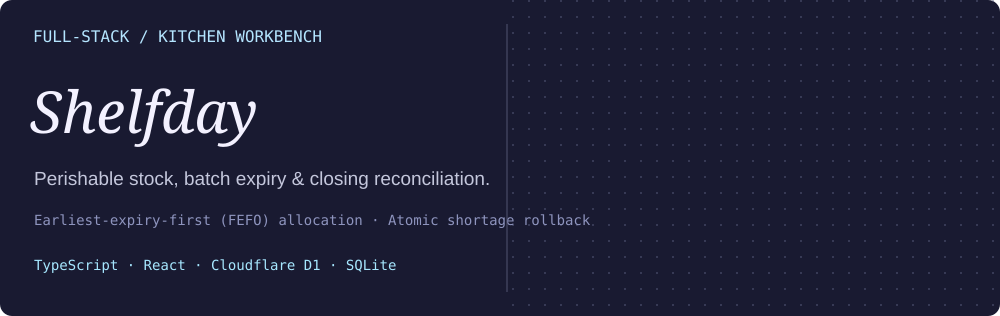

  

### `whoami`

- 🎓 I'm a final-year **Computer Science (AI & ML)** engineering student at AITM, Bhatkal (Class of 2027).

- 💻 I build **backend systems and full-stack software** in Python and TypeScript, with a focus on reliable APIs, structured data workflows, and local-first architecture.

- ⚙️ I founded **Omnimate** and led a team delivering client software, alongside internships covering retail platforms, applied AI, machine learning, and cloud infrastructure.

- 🛡️ On the side, I'm exploring **cybersecurity**—learning how systems fail under attack and how to design software with defensible boundaries.

- 🔨 I put real effort into verifiable engineering: writing clean tests, handling failure modes upfront, and making edge cases explicit.

 

### GitHub activity

 

### Featured build

#### 🍲 [Shelfday](https://github.com/ZephyrusZorro/shelfday)

**What if a kitchen could track batch expiry before the morning rush?** Small commercial kitchens need to know which ingredient batch to use first and reconcile what happened before closing the day. I built a daily prep and perishable-stock workbench using TypeScript, React, and Cloudflare D1 with SQLite.

Shelfday implements earliest-expiry-first (FEFO) allocation across ingredient batches, prep suggestions based on comparable weekdays, and locked closing summaries. The illustration shows the batch lifecycle; the repository includes the full client and database workflows.

[Explore the project ↗](https://github.com/ZephyrusZorro/shelfday) · [View architecture docs](https://github.com/ZephyrusZorro/shelfday#readme)

### Selected projects

#### 🎬 [Cueproof ↗](https://zephyruszorro.github.io/cueproof/)

Caption revisions are frustrating to review when wording changes, timing drifts, and reviewer notes live in separate documents. I built a browser-based caption revision desk to compare reference and revision subtitle tracks.

**Inside Cueproof** · The parser, text comparisons, and audio-video playback run entirely in the browser using IndexedDB. Reviewers see cue-level text additions and removals alongside synchronized video, with follow-up rounds and portable JSON backups. [Try the live demo ↗](https://zephyruszorro.github.io/cueproof/)

#### 🧠 [TarkAI (तर्क) ↗](https://github.com/ZephyrusZorro/tark-ai)

A local Python practice studio with syntax tree feedback, test execution, and spaced review for engineers.

**Inside TarkAI** · Instead of running untrusted code blindly, TarkAI inspects the Python 3.12 Abstract Syntax Tree (AST) to provide structural feedback and heuristic complexity estimates. Timed subprocess runs evaluate solutions against test suites, paired with Leitner spaced review intervals. [Explore the studio ↗](https://github.com/ZephyrusZorro/tark-ai)

#### 🏥 [Vaani Clinical](https://github.com/ZephyrusZorro/vaani-clinical)

- **Intake simulation** · Guides clinical encounters through a conversational state machine.

- **Structured notes** · Synthesizes typed encounter records into structured SOAP clinical documentation.

- **Standards export** · Transforms clinical notes and vitals into valid FHIR R4 JSON bundles.

 

#### 🩺 [NephroGuard](https://github.com/ZephyrusZorro/nephroguard)

- **Renal review** · Organizes patient lab trends, encounter history, and medication timelines.

- **Clinical handoff** · Generates structured handoff summaries for shift transitions.

- **Local storage** · Powered by SQLite persistence with FHIR R4 compatibility.

 

#### 📊 [Kuber Data Core](https://github.com/ZephyrusZorro/kuber-datacore)

- **Document extraction** · Resilient async crawler and DOM pruner extracting corporate research data.

- **Relationship graphs** · Snapshots corporate links and valuation metrics aligned with FIBO / SEC EDGAR schemas.

- **Repeatability** · Bounded request pipelines ensure analytical claims trace directly back to source filings.

 

### `cat field-notes/shelfday`

The hardest bug in inventory software isn't adding numbers—it's dealing with partial cancellations. When an order is cancelled halfway through kitchen prep, you cannot simply delete the line item. You have to return that exact portion to the specific lot it was drawn from, or your expiry sequence breaks. Making rollback an atomic state transition instead of an afterthought is what makes the ledger dependable. [Shelfday source code](https://github.com/ZephyrusZorro/shelfday)

### On my workbench

**LeakageGuard** · My final-year B.E. project. I'm building developer tooling that checks Python ML workflows and datasets for preprocessing leakage, train/test duplicate records, group overlap, and temporal target leakage before models are evaluated on contaminated data.

**Local-First Workstations** · Exploring local-first developer tooling with SQLite and IndexedDB, while keeping up with security fundamentals (OWASP Top 10, secure API design) through hands-on practice.

### Tools in practice

| Area | Where I use it |
| --- | --- |
| **Python & FastAPI** | Backend microservices, typed APIs, and data workflows in TarkAI, Vaani Clinical, NephroGuard, and Kuber Data Core. |
| **TypeScript & React** | Client-side workbenches in Shelfday and Cueproof; managing state transitions, IndexedDB persistence, and media sync. |
| **Databases & Storage** | SQLite, PostgreSQL, and Cloudflare D1 for local-first persistence, relational integrity, and structured records. |
| **Applied AI & ML** | AST syntax inspection in LeakageGuard and TarkAI; conversational state machines in clinical simulations. |
| **Git & CI/CD** | Automated testing with pytest, Docker container setups, and GitHub Actions telemetry automation. |

### A few things I've learned

**Model the failure mode before the happy path.** In Shelfday, ingredients don't just get used; batches expire, orders get cancelled, and count mistakes happen. Designing the rollback and closing reconciliation first made the day-to-day workflow much simpler to reason about.

**Static checks are cheaper than runtime surprises.** In LeakageGuard, checking code structure with the Python AST catches methodological mistakes in milliseconds, before anyone trains a model on contaminated data.

**Keep state inspectable.** Whether it's a FHIR bundle in Vaani Clinical or a relationship graph in Kuber Data Core, software is easier to trust when you can point to the exact record and timestamp that produced a number.

Systems Lab artwork &amp; portrait

  

  
  

16 public repositories

| Repository | Description | Language |
| :--- | :--- | :--- |
| [ai-traffic-signal-optimization](https://github.com/ZephyrusZorro/ai-traffic-signal-optimization) | OpenCV video simulation for adaptive signal timing and emergency vehicle priority. | Python |
| [case-vault](https://github.com/ZephyrusZorro/case-vault) | Case document management; encrypted records, access control, and audit logs. | Python |
| [cueproof](https://github.com/ZephyrusZorro/cueproof) | Private-by-design caption revision review for SRT and WebVTT tracks. | TypeScript |
| [health-docker](https://github.com/ZephyrusZorro/health-docker) | Hospital Management System stack with Laravel backend, Next.js frontend, and Docker Compose. | PHP |
| [kuber-datacore](https://github.com/ZephyrusZorro/kuber-datacore) | Local document ingestion with bounded HTTP requests, graph snapshots and a repeatable benchmark. | Python |
| [lablens](https://github.com/ZephyrusZorro/lablens) | Electronics lab assistant with component detection and page-cited retrieval. | Python |
| [market-cortex](https://github.com/ZephyrusZorro/market-cortex) | Local-first, point-in-time market data, analytics, and evidence-grounded research. | Python |
| [mendroom](https://github.com/ZephyrusZorro/mendroom) | Local repair-event intake, volunteer matching and transactional backup restore. | TypeScript |
| [nephroguard](https://github.com/ZephyrusZorro/nephroguard) | Renal review and clinical handoff training workspace with FHIR R4 export and SQLite. | Python |
| [Omnimate-Shots](https://github.com/ZephyrusZorro/Omnimate-Shots) | Screenshot metadata ingestion and search API for Omnimate. | TypeScript |
| [project-mrindustries](https://github.com/ZephyrusZorro/project-mrindustries) | Flask and OpenCV virtual try-on proof of concept from an internship assessment. | Python |
| [shelfday](https://github.com/ZephyrusZorro/shelfday) | Kitchen stock and prep with expiry-aware allocation, shortage rollback and retry-safe writes. | TypeScript |
| [tark-ai](https://github.com/ZephyrusZorro/tark-ai) | Local-first intelligent code auditor, AST semantic analyzer and Socratic tutor. | Python |
| [vaani-clinical](https://github.com/ZephyrusZorro/vaani-clinical) | Educational clinical intake and FHIR R4 documentation simulation. | Python |
| [vox-ai](https://github.com/ZephyrusZorro/vox-ai) | Vox AI - AI Voice Receptionist for Clinics. | TypeScript |
| [ZephyrusZorro](https://github.com/ZephyrusZorro/ZephyrusZorro) | Systems Lab profile with animated SVG terminal telemetry &amp; automated CI/CD pipeline. | Python |

### Get in touch

I'm a final-year AI & ML student in Bhatkal, interested in internships and graduate roles in software engineering, backend systems, and full-stack development. If you work on reliable data workflows, local-first tools, or useful developer software, I'd enjoy hearing from you.

[Digital Workshop](https://zephyruszoro09.vercel.app/) · [LinkedIn](https://www.linkedin.com/in/faris-ruknuddin-3656762b9/) · [Email](mailto:farisruknuddin@gmail.com)
