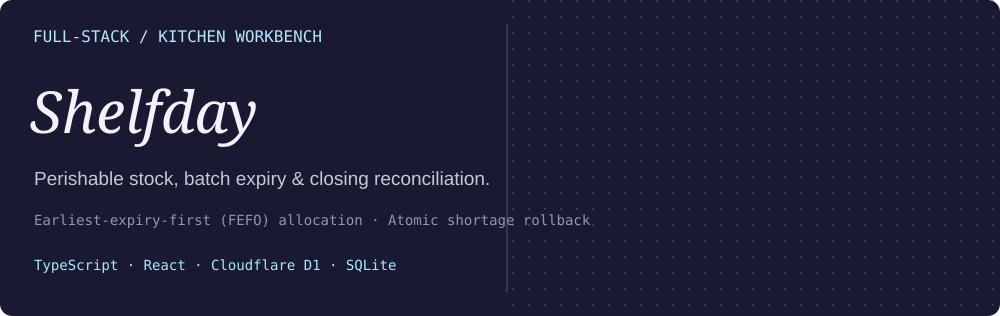

  

### `whoami`

- 🎓 I'm a final-year **Computer Science (AI & ML)** engineering student at AITM, Bhatkal (Class of 2027).

- 💻 I build **backend systems and full-stack software** in Python and TypeScript, with a focus on reliable APIs, structured data workflows, and local-first architecture.

- ⚙️ I founded **Omnimate** and led a team delivering client software, alongside internships covering retail platforms, applied AI, machine learning, and cloud infrastructure.

- 🛡️ On the side, I'm exploring **cybersecurity**—learning how systems fail under attack and how to design software with defensible boundaries.

- 🔨 I put real effort into verifiable engineering: writing clean tests, handling failure modes upfront, and making edge cases explicit.

 

### GitHub activity

 

### Flagship builds

#### 🛡️ [TraceGuard ↗](https://github.com/ZephyrusZorro/traceguard)

Causal multi-agent failure attribution (**C³-Attributor**), CaMeL-inspired prompt-injection capability firewall, and time-travel counterfactual replay for OpenTelemetry GenAI traces (`Python`, `FastAPI`, `React 19`, `TypeScript`, `MCP`).

#### 🔬 [PARALLAX v2.0 ↗](https://github.com/ZephyrusZorro/parallax)

Neuro-symbolic multimodal causal digital twin & counterfactual resilience engine combining invertible SCMs, FLIR/optical inspection, an 8-agent council, Pearl `do()` simulations, and SHA-256 audit governance (`Python`, `FastAPI`, `React`, `MCP`, `Docker`).

#### 🎙️ [RelayDesk 2.0 ↗](https://github.com/ZephyrusZorro/relaydesk)

Voice-enabled IT support operations workbench orchestrated in n8n with three local Ollama specialist agents, a durable SQLite lease worker, and versioned BM25+RRF hybrid RAG (`Python`, `FastAPI`, `n8n`, `LangChain`, `Ollama`, `Docker`).

#### 📈 [Market Cortex ↗](https://github.com/ZephyrusZorro/market-cortex)

Local-first, point-in-time market data, analytics, and evidence-grounded quantitative research workstation with content-addressed Parquet manifests, DuckDB, PostgreSQL, and Next.js.

#### 🪵 [Offcut Atlas ↗](https://github.com/ZephyrusZorro/offcut-atlas)

Local-first material planning workbench for picture-framing studios turning commissions into verified cut drawings, traceable offcut racks, and two-order lookahead simulations (`Python 3.12`, `SQLite`).

#### 💹 [CRYPTOZ ↗](https://cryptoz-seven.vercel.app) · [Source](https://github.com/ZephyrusZorro/cryptoz)

Crypto market research workstation with live Binance feeds, chart studies, market breadth, and paper trading — deployed live on Vercel.

#### 🍲 [Shelfday](https://github.com/ZephyrusZorro/shelfday)

**What if a kitchen could track batch expiry before the morning rush?** Small commercial kitchens need to know which ingredient batch to use first and reconcile what happened before closing the day. I built a daily prep and perishable-stock workbench using TypeScript, React, and Cloudflare D1 with SQLite — featuring earliest-expiry-first (FEFO) batch allocation, atomic shortage rollback, and locked closing summaries.

[Explore Shelfday ↗](https://github.com/ZephyrusZorro/shelfday) · [View architecture docs](https://github.com/ZephyrusZorro/shelfday#readme)

### More selected engineering work

#### 🎬 [Cueproof ↗](https://zephyruszorro.github.io/cueproof/) · [Source](https://github.com/ZephyrusZorro/cueproof)

Private-by-design browser caption revision desk for comparing SRT and WebVTT tracks against synchronized video with IndexedDB storage, follow-up rounds, and portable JSON backups.

#### 🛡️ [Vigil ↗](https://github.com/ZephyrusZorro/vigil)

Local-first unified deadline, compliance, license, and contract intelligence platform with a deterministic 0–100 risk engine, alert thresholds, and native Node.js SQLite WAL storage (`TypeScript`, `React`, `Express`, `SQLite`).

#### 🧠 [TarkAI (तर्क) ↗](https://github.com/ZephyrusZorro/tark-ai)

Local Python practice studio combining Python 3.12 AST semantic introspection, Halstead complexity metrics, timed subprocess test runs, Socratic mentoring tiers, and Leitner spaced review.

 

### `cat field-notes/shelfday`

The hardest bug in inventory software isn't adding numbers—it's dealing with partial cancellations. When an order is cancelled halfway through kitchen prep, you cannot simply delete the line item. You have to return that exact portion to the specific lot it was drawn from, or your expiry sequence breaks. Making rollback an atomic state transition instead of an afterthought is what makes the ledger dependable. [Shelfday source code](https://github.com/ZephyrusZorro/shelfday)

### On my workbench

**LeakageGuard** · My final-year B.E. project. Developer tooling that checks Python ML workflows and datasets for preprocessing leakage, train/test duplicate records, group overlap, and temporal target leakage before models are evaluated on contaminated data.

**AI Reliability & Local-First Systems** · Building verifiable agentic systems (causal attribution, prompt-injection capability firewalls, counterfactual replay) alongside local-first tools backed by SQLite, DuckDB, and IndexedDB.

### Tools in practice

| Area | Where I use it |
| --- | --- |
| **Python & FastAPI** | Backend APIs, causal/ML engines, and data pipelines across TraceGuard, PARALLAX, RelayDesk, Market Cortex, Offcut Atlas, and TarkAI. |
| **TypeScript & React** | Interactive workbenches and dashboards in TraceGuard, PARALLAX, Shelfday, Cueproof, Vigil, and CRYPTOZ. |
| **Databases & Storage** | SQLite (WAL/FTS5), PostgreSQL, DuckDB, Parquet, Cloudflare D1, and IndexedDB for local-first and analytical workloads. |
| **Applied AI & Security** | Multi-agent orchestration (n8n, Ollama, MCP), OpenTelemetry GenAI tracing, prompt-injection firewalls, AST analysis, and causal SCMs. |
| **DevOps & Verification** | Automated pytest/Playwright/Vitest suites, Docker Compose, GitHub Actions CI/CD, and Vercel deployments. |

### A few things I've learned

**Model the failure mode before the happy path.** In Shelfday, ingredients don't just get used; batches expire, orders get cancelled, and count mistakes happen. Designing the rollback and closing reconciliation first made the day-to-day workflow much simpler to reason about.

**Static checks are cheaper than runtime surprises.** In LeakageGuard, checking code structure with the Python AST catches methodological mistakes in milliseconds, before anyone trains a model on contaminated data.

**Keep state inspectable.** Whether it's a FHIR bundle in Vaani Clinical or a relationship graph in Kuber Data Core, software is easier to trust when you can point to the exact record and timestamp that produced a number.

Systems Lab artwork &amp; portrait

  

  
  

23 public repositories

| Repository | Description | Language |
| :--- | :--- | :--- |
| [ai-traffic-signal-optimization](https://github.com/ZephyrusZorro/ai-traffic-signal-optimization) | Real-time OpenCV traffic signal optimizer with adaptive MOG2 queue-density timing and emergency vehicle preemption. | Python |
| [case-vault](https://github.com/ZephyrusZorro/case-vault) | Case document management with encrypted evidence storage, role-based access controls, version history, and tamper-evident audit logs. | Python |
| [cryptoz](https://github.com/ZephyrusZorro/cryptoz) | Crypto market research, chart studies, market breadth, and paper trading workstation with live Vercel demo. | JavaScript |
| [cueproof](https://github.com/ZephyrusZorro/cueproof) | Private-by-design browser caption revision review desk for SRT and WebVTT tracks with live demo. | TypeScript |
| [health-docker](https://github.com/ZephyrusZorro/health-docker) | Containerized Hospital Management System stack with Laravel 12 API, Next.js 15 frontend, FEFO pharmacy, and Docker Compose. | PHP |
| [kuber-datacore](https://github.com/ZephyrusZorro/kuber-datacore) | Local financial research workstation with bounded document ingestion, FIBO relationship graphs, and repeatable DAG pipelines. | Python |
| [lablens](https://github.com/ZephyrusZorro/lablens) | Hands-free electronics lab mentor with ONNX component detection, MediaPipe pointing, and page-cited datasheet retrieval. | Python |
| [market-cortex](https://github.com/ZephyrusZorro/market-cortex) | Local-first, point-in-time market data, analytics, and evidence-grounded quantitative research workstation. | Python |
| [mendroom](https://github.com/ZephyrusZorro/mendroom) | Local-first community repair cafe workbench with skill-aware volunteer matching and transactional backup restore. | TypeScript |
| [nephroguard](https://github.com/ZephyrusZorro/nephroguard) | Zero-dependency local renal review and clinical I-PASS handoff training workspace with FHIR R4 export and SQLite. | Python |
| [offcut-atlas](https://github.com/ZephyrusZorro/offcut-atlas) | Material planning workbench for framing studios with verified cut lists, traceable offcuts, and two-order lookahead. | Python |
| [Omnimate-Shots](https://github.com/ZephyrusZorro/Omnimate-Shots) | TypeScript API for screenshot ingestion, JSON metadata indexing, and filtered HTTP search. | TypeScript |
| [parallax](https://github.com/ZephyrusZorro/parallax) | PARALLAX v2.0 — Neuro-symbolic multimodal causal digital twin &amp; counterfactual resilience engine. | Python |
| [project](https://github.com/ZephyrusZorro/project) | Archive of my early HTML/CSS/JS portfolio — current 3D studio &amp; engineering portfolio is live at zephyruszoro09.vercel.app. | HTML |
| [project-mrindustries](https://github.com/ZephyrusZorro/project-mrindustries) | Flask and OpenCV virtual try-on proof of concept built for a multi-community e-commerce internship assessment. | Python |
| [relaydesk](https://github.com/ZephyrusZorro/relaydesk) | Voice-enabled IT support ops workbench in n8n with multi-agent Ollama LLMs, durable SQLite worker, and cached hybrid RAG. | JavaScript |
| [shelfday](https://github.com/ZephyrusZorro/shelfday) | Daily kitchen stock and prep workbench with FEFO batch expiry allocation, atomic shortage rollback, and retry-safe writes. | TypeScript |
| [tark-ai](https://github.com/ZephyrusZorro/tark-ai) | Local-first Python AST code auditor, Halstead complexity analyzer, timed test runner, and Socratic practice studio. | Python |
| [traceguard](https://github.com/ZephyrusZorro/traceguard) | Causal multi-agent failure attribution (C3-Attributor), CaMeL-inspired prompt-injection firewall, and OTel counterfactual replay. | Python |
| [vaani-clinical](https://github.com/ZephyrusZorro/vaani-clinical) | Educational clinical intake simulation synthesizing structured SOAP notes and HL7 FHIR R4 bundles. | Python |
| [vigil](https://github.com/ZephyrusZorro/vigil) | Local-first unified deadline, compliance, license, and contract intelligence platform with automated 0–100 risk prioritization. | TypeScript |
| [vox-ai](https://github.com/ZephyrusZorro/vox-ai) | Real-time clinic voice receptionist platform with LiveKit audio pipelines, Sarvam/Gemini providers, and FastAPI dashboards. | TypeScript |
| [ZephyrusZorro](https://github.com/ZephyrusZorro/ZephyrusZorro) | Systems Lab GitHub profile with automated telemetry, contribution heatmap, and repository showcase. | Python |

### Get in touch

I'm a final-year AI & ML student in Bhatkal, interested in internships and graduate roles in software engineering, backend systems, and full-stack development. If you work on reliable data workflows, local-first tools, or useful developer software, I'd enjoy hearing from you.

[Digital Workshop](https://zephyruszoro09.vercel.app/) · [LinkedIn](https://www.linkedin.com/in/faris-ruknuddin-3656762b9/) · [Email](mailto:farisruknuddin@gmail.com)
